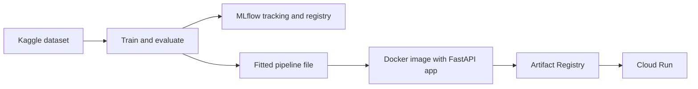

# Titanic MLOps

[](https://github.com/mwilliams2112/titanic-mlops/actions/workflows/ci.yml)

A small end-to-end machine learning system: train a model, track it, serve it behind a validated API, package it in a container, and test, build and deploy it automatically.

The model is deliberately simple (a random forest on four features of the Titanic dataset). The point of the project is the engineering around the model, not its accuracy.

**Live demo:** [interactive API docs](https://YOUR-CLOUD-RUN-URL/docs) (hosted on Google Cloud Run; the first request after a quiet period is slower because the service scales to zero).

```bash
curl -X POST https://YOUR-CLOUD-RUN-URL/predict \
  -H "Content-Type: application/json" \
  -d '{"Pclass": 1, "Sex": "female", "SibSp": 0, "Parch": 0}'
```

## What this demonstrates

- A notebook refactored into a tested Python package, with preprocessing and model combined in a single scikit-learn Pipeline to avoid training/serving skew
- Experiment tracking and a model registry with MLflow
- A FastAPI service with strict input validation
- A Docker image built reproducibly from a lockfile, with cached dependency layers and a non-root user
- GitHub Actions CI that runs the tests, trains a model, builds the image, smoke-tests the running container, then pushes it to Artifact Registry and deploys it to Cloud Run
- Keyless authentication from CI to Google Cloud using Workload Identity Federation

## Architecture



1. The dataset is downloaded with `kagglehub` and split into train and test sets.
2. A single Pipeline (one-hot encoding of `Sex` plus a random forest) is fitted on the training set and compared against a majority-class baseline.
3. Parameters, metrics and the model are logged to MLflow, and the fitted pipeline is saved to disk.
4. The FastAPI app loads the pipeline once at startup, validates each request, and returns a prediction and probability.
5. CI builds the image, smoke-tests it, pushes it tagged with the commit SHA, and deploys it.

## Quick start

Requires [uv](https://docs.astral.sh/uv/) and, for the container, Docker.

```bash
# Install dependencies (including the training extras) from the lockfile
uv sync --extra train

# Train, evaluate against the baseline, log to MLflow and save the model
uv run python -m titanic.train

# Run the tests
uv run pytest

# Serve locally, then open http://127.0.0.1:8000/docs
uv run uvicorn titanic.api:app --reload
```

Browse the tracked runs and registered model versions:

```bash
uv run mlflow ui --backend-store-uri sqlite:///mlflow.db --port 5001
```

Run the container (train first, because the image copies in the saved model):

```bash
docker build -t titanic-api .
docker run --rm -p 8000:8000 titanic-api
```

## API

| Endpoint | Method | Purpose |
| --- | --- | --- |
| `/health` | GET | Liveness check |
| `/predict` | POST | Survival prediction for one passenger |
| `/docs` | GET | Interactive API documentation, generated from the request models |

Request fields are validated: `Pclass` must be 1, 2 or 3, `Sex` must be `male` or `female`, and `SibSp` and `Parch` must be integers from 0 to 10. Anything else returns a 422 response naming the offending field.

The response contains `prediction` (0 or 1) and `probability` (the predicted probability of survival). The exact values depend on the trained model.

## Project structure

```
src/titanic/
    config.py      constants: features, hyperparameters, seed, model path
    data.py        download, load and split the data
    model.py       builds the unfitted scikit-learn Pipeline
    evaluate.py    returns metrics as a dictionary of plain floats
    train.py       training entry point (baseline, fit, evaluate, track, save)
    predict.py     load the saved model and predict from raw records
    api.py         FastAPI application
tests/             unit and API tests, with shared fixtures in conftest.py
Dockerfile         lockfile-based image build
.github/workflows/ci.yml
```

## Design decisions

- **One Pipeline for preprocessing and model.** The encoder is fitted once and saved with the model, so serving applies exactly the transformation used in training.
- **A baseline in every run.** Metrics mean little without a reference, so each run records the majority-class baseline alongside the model.
- **Strict API, lenient model.** The model tolerates unknown categories so it does not crash, while the API rejects invalid input with a clear error.
- **Model loaded once at startup.** A missing model file fails the app immediately, not on the first request.
- **Tests that need no files or network.** Fixtures use small hand-built data, and assertions check properties (shapes, ranges, ordering) instead of exact floats.
- **Lockfile and layered Docker build.** `uv.lock` pins every dependency, and dependencies sit in their own image layer, so a code change rebuilds in seconds.
- **Commit-SHA image tags.** Each deployed service can be traced to the exact commit, and any earlier version can be redeployed.
- **Keyless CI authentication.** Workload Identity Federation exchanges a short-lived GitHub token for temporary cloud access, so there is no stored key to leak.

## CI/CD

On every push and pull request, the workflow runs the tests, then trains a model and builds the image for `linux/amd64`, and smoke-tests the running container against `/health` and `/predict`. On pushes to `master` it also pushes the image to Artifact Registry and deploys it to Cloud Run, then checks the live service.

## Results

On a single stratified test split of 179 passengers, the model reaches roughly 0.8 accuracy against about 0.61 for the majority-class baseline. Treat the comparison as indicative: the test set is small, and hyperparameters were compared on that one split. Full metrics for every run are in MLflow.

## Limitations and next steps

- **No monitoring yet.** Next: operational metrics from the API, plus drift detection (for example with Evidently) demonstrated by sending shifted data to the live endpoint.
- **The model is baked into the image.** At scale the model would be loaded from a registry by alias, so code and model can be released independently.
- **Deliberately simple deployment.** The service is public with an instance cap, and the deployer account has a broad role. A production setup would add authentication and rate limiting, tighter permissions, staged environments and approval gates.
- **Sex is used as a feature.** It is historically meaningful in this dataset, but would be a protected attribute in most real settings, where fairness assessment and documentation would be needed.
